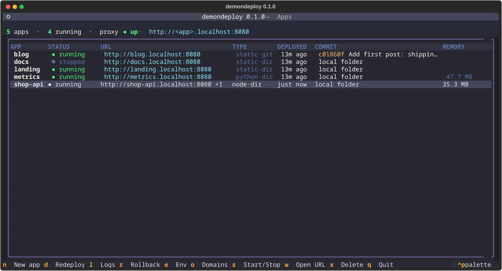
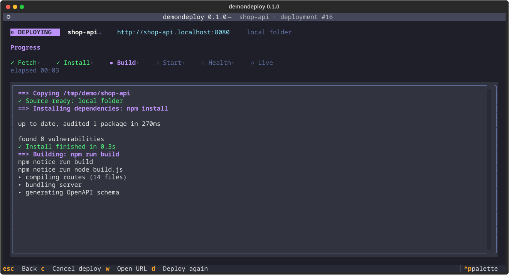
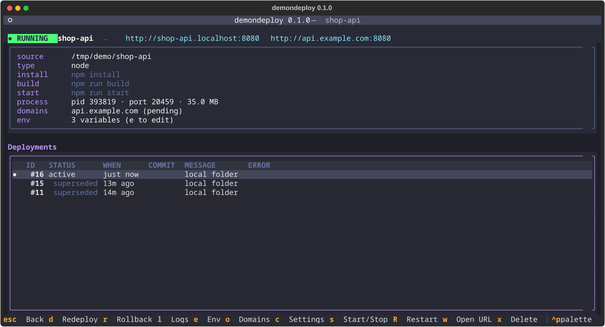
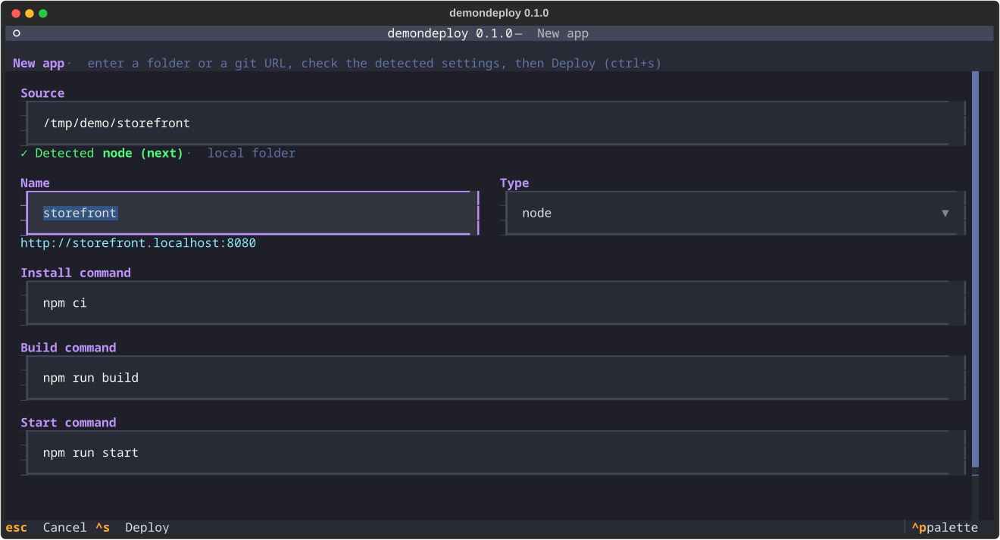
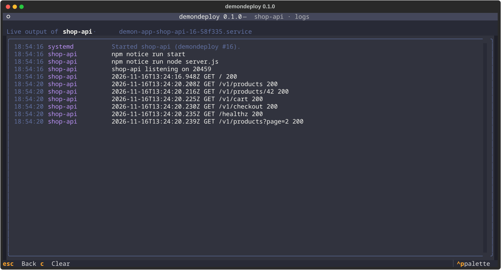
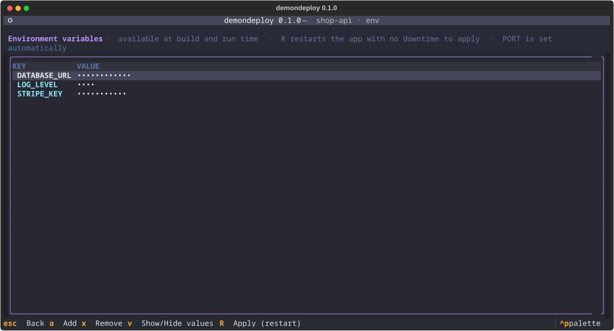
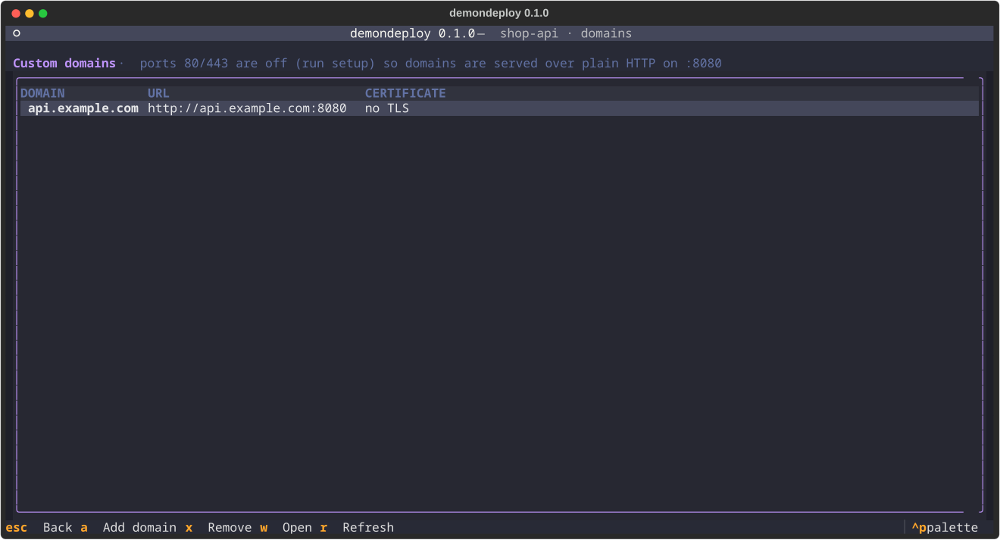
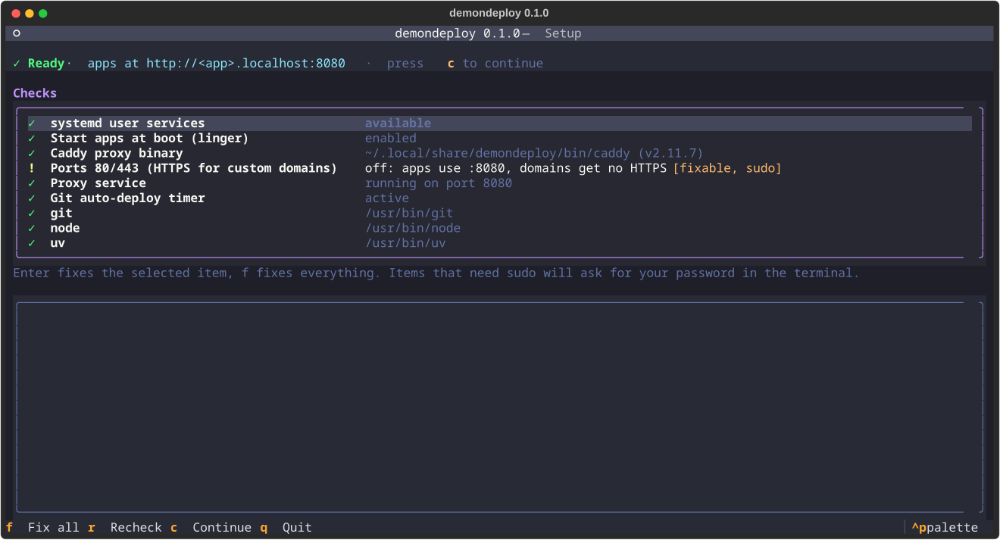

# demondeploy

Vercel-style deployments on your own machine. Point `demon` at a folder or a git repo. It works out what kind of app it is, builds it, and runs it as a **systemd user service** behind a built-in **Caddy** proxy. Your apps get addresses like `http://my-app.localhost`, and custom domains get **HTTPS automatically**. Apps come back on their own after a crash or a reboot.

```bash
demon                      # the dashboard (TUI)
demon deploy ./my-app      # deploy a folder (opens the guided setup)
demon deploy https://github.com/you/site.git
```



- **Detects the app.** Supports Node (Next.js, Nuxt, SvelteKit, Remix, Astro, Express, Fastify, NestJS, …), Python (FastAPI, Flask, Django, or a plain script) and static sites (plain HTML, Vite, CRA, Angular, Next static export). Anything else works too: you enter the build and start commands.
- **Zero-downtime deploys.** The new version starts next to the old one on a new port. It has to pass a health check before traffic switches over, and only then is the old version stopped.
- **Failed deploys are harmless.** If a build breaks or the app crashes on start, the previous version keeps serving.
- **Instant rollback.** The last 5 builds are kept, so rolling back does not rebuild anything.
- **Survives everything.** Crashes trigger an automatic restart. Apps start at boot even before you log in (linger), and `demon doctor` repairs anything that has drifted from the saved state.
- **Deploys from git automatically.** It checks for new commits every minute.
- **Custom domains with automatic HTTPS** (Let's Encrypt). `*.internal`, `*.lan` and `*.local` names get certificates from a local CA.
- **Environment variables**, applied with a zero-downtime restart.
- **Builds run in the background.** They run in their own systemd unit, so closing the terminal does not stop a deploy.

## Install

Download the latest release binary (no Python needed):

```bash
sudo wget -O /usr/local/bin/demon "https://github.com/Project-Delilah/demondeploy/releases/latest/download/demon-$(uname -s | tr '[:upper:]' '[:lower:]')-$(uname -m)" && sudo chmod +x /usr/local/bin/demon && demon setup
```

The binary goes in `/usr/local/bin`, not `/bin`: `/bin` belongs to the package manager on Linux and is read-only on macOS. macOS has no `wget` by default, so use `sudo curl -fL -o /usr/local/bin/demon "<same URL>"` instead. Binaries are built for Linux (x86_64, aarch64; glibc 2.35+) and macOS (arm64, x86_64), and each release has a `SHA256SUMS` file.

> **Deploying needs Linux with systemd.** The macOS binary runs, but demondeploy manages apps through systemd user services, which macOS doesn't have.

You also need `git` for repos, `node` for Node apps and `uv` for Python apps.

From source (Python 3.11+ and [uv](https://docs.astral.sh/uv/)):

```bash
cd demondeploy
uv tool install -e .     # puts `demon` on your PATH
demon setup
```

## Releasing

Push a version tag. [`.github/workflows/release.yml`](.github/workflows/release.yml) runs the tests, builds a standalone binary on each platform with PyInstaller, smoke-tests it and publishes a GitHub release:

```bash
git tag v0.1.0 && git push origin v0.1.0
```

`demon setup` shows a checklist and fixes each item:

| Item | What it does |
| --- | --- |
| Start apps at boot | `loginctl enable-linger $USER`. Apps keep running when you are logged out and start at boot. |
| Caddy | Uses `caddy` from your PATH. If there is none, it downloads Caddy 2.11.7 from GitHub and checks its published checksum. |
| Ports 80/443 *(optional, sudo)* | Writes `net.ipv4.ip_unprivileged_port_start=80` to `/etc/sysctl.d/50-demondeploy.conf`. Without this, apps are served on `:8080` and domains don't get HTTPS. |
| Proxy service | `demon-proxy.service` (Caddy) |
| Auto-deploy timer | `demon-poll.timer` checks git sources every minute |

## The dashboard

Run `demon` with no arguments. The screens below are from real deployments.

**Deploying.** The build runs in the background with live progress, and `esc` doesn't stop it.



**App details.** Shows the process, port, memory, domains and deployment history. Select an older deployment and press `r` to roll back to it.



**New app.** Shows the detected type and commands. Edit anything, then press `ctrl+s` to deploy.



| Live logs | Environment variables |
| --- | --- |
|  |  |
| **Custom domains** | **Setup checklist** |
|  |  |

### Keys

| Key | |
| --- | --- |
| `n` | new app: enter a folder or git URL, check the detected commands, `ctrl+s` to deploy |
| `enter` | app details: deployment history, process info, domains |
| `d` / `r` | redeploy / roll back (in the details screen, roll back to the selected deployment) |
| `l` / `b` | live app logs / build log of the selected deployment |
| `e` / `o` / `c` | environment variables / domains / settings (commands, health check path, branch) |
| `s` / `R` | start-stop / zero-downtime restart |
| `w` | open in the browser |
| `x` | delete the app |

## Command line

Every action in the dashboard is also available as a command, for scripts and CI.

```
demon deploy [PATH|GIT_URL|APP] [--name N] [--branch B] [--no-auto] [-y] [--detach]
             [--install CMD] [--build CMD] [--start CMD] [--static DIR]
demon ls | status APP
demon logs APP [-f] [--build [ID]]
demon rollback APP [ID]
demon restart | stop | start APP
demon env ls|set|rm APP [KEY=VALUE…] [--reveal] [--restart]
demon domains ls|add|rm [APP] [DOMAIN]
demon rm APP
demon setup | doctor
```

## Your app's contract

- Listen on the **`PORT`** environment variable. Binding to `127.0.0.1` is enough, because the proxy is on the same machine.
- Answer `GET /` (or your health path) with a status below 500 within 90 seconds of starting.
- To override detection, add a `demon.toml` to the repo:

```toml
kind = "command"            # node | python | static | command
install = "go mod download"
build = "go build -o server ."
start = "./server"
health = "/healthz"
# static = "public"        # for static sites: the folder to serve
```

## Custom domains

1. Create an `A`/`AAAA` record pointing at this machine. Behind a home router, forward ports 80 and 443 to it.
2. Run `demon domains add my-app app.example.com`, or press `o` in the dashboard. The DNS is checked for you.
3. Caddy gets and renews the certificate itself. HTTP is redirected to HTTPS.

## Where things live

| Path | |
| --- | --- |
| `~/.local/share/demondeploy/state.db` | apps, deployments, env vars, domains (SQLite, mode 600) |
| `~/.local/share/demondeploy/projects/<app>/deployments/<id>/` | source snapshot, build output, `deploy.log` |
| `~/.local/share/demondeploy/caddy/` | generated proxy config and certificates |
| `~/.config/systemd/user/demon-*.service` | generated units (don't edit; `demon doctor` rewrites them) |

## How it works

```
             ┌──────────────── demon-proxy.service (Caddy, :80/:443 or :8080) ───────────────┐
 browser ──▶ │ my-app.localhost / app.example.com ──▶ 127.0.0.1:<port>  or  static file_server │
             └───────────────────────────────────────────────────────────────────────────────┘
                                         ▲ graceful reload
 demon deploy ─▶ demon-deploy-<app>-<id>  (transient unit: fetch → install → build)
                     └─▶ demon-app-<app>-<id>-<tok>.service on a new port ─▶ health check
                         ─▶ switch proxy ─▶ stop old unit
```

- **State.** The SQLite DB is the source of truth. Unit files and the Caddy config are generated from it. At every boot, `ExecStartPre` of the proxy runs `demon _reconcile --boot` to put systemd back in line with the DB.
- **Locking.** There is one lock per app, so two deploys of the same app never overlap.
- **Builds.** Builds use your shell's `PATH` (saved whenever you run `demon`), so `nvm`/`fnm`/`pyenv` toolchains are found by background builds too.

## Development

```bash
uv run pytest
uv run demon --help
```
